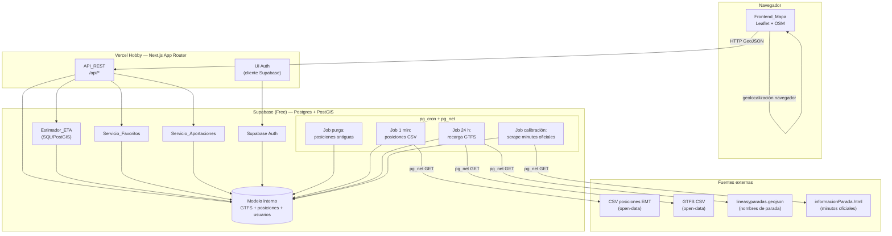
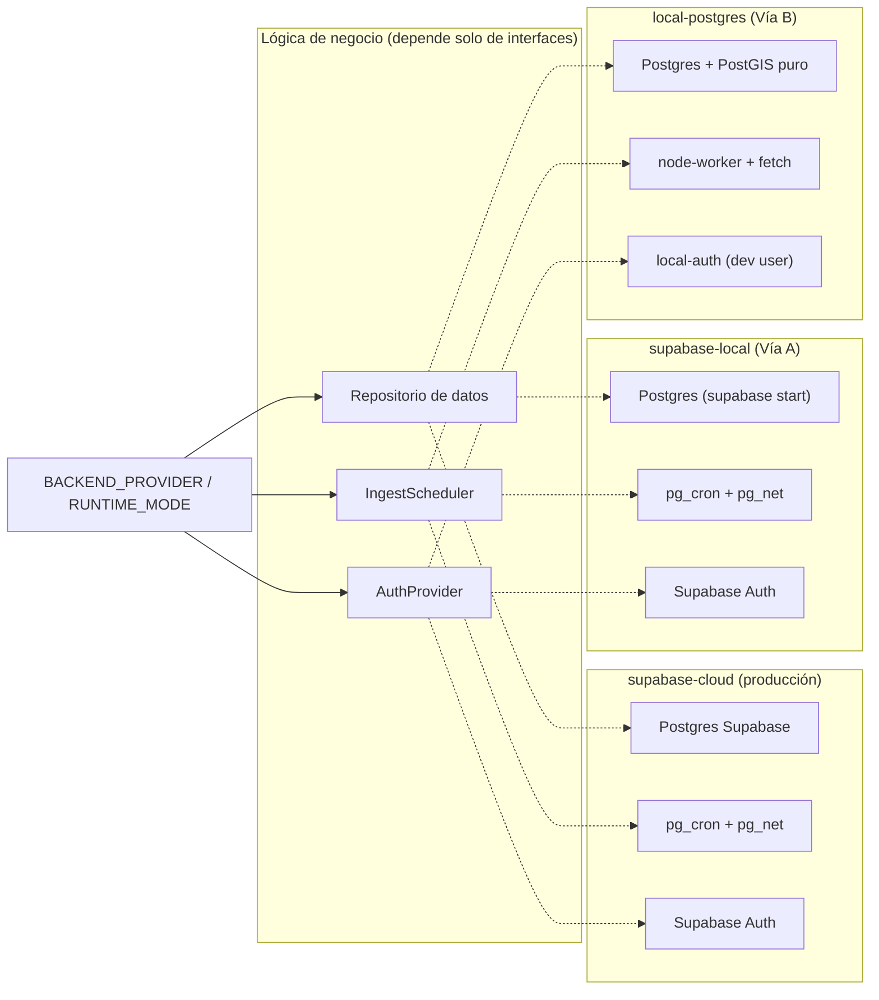
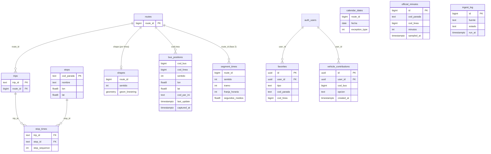

# Documento de Diseño

## Overview

Buses de Málaga es una aplicación web serverless que amplía y mejora la fiabilidad del seguimiento de autobuses de la EMT de Málaga. El diseño se ajusta a las decisiones arquitectónicas fijadas en `SPEC.md` y satisface los doce requisitos funcionales de `requirements.md`, operando íntegramente dentro de planes gratuitos (Vercel Hobby + Supabase Free).

La arquitectura reparte responsabilidades en dos planos:

- **Plano de recolección (Supabase).** Toda la ingesta periódica vive dentro de la base de datos mediante `pg_cron` + `pg_net`. Esta decisión es forzosa: el cron de Vercel Hobby está limitado a una ejecución diaria y no puede sostener el polling de 1 minuto que exigen las posiciones en tiempo real (Requisito 12). Supabase Postgres con PostGIS almacena el modelo normalizado, ejecuta el map-matching y los cálculos de distancia en SQL, y provee además la autenticación (Supabase Auth) para el Requisito 7.
- **Plano de presentación/lectura (Vercel).** Next.js (App Router) sirve el frontend y las rutas `/api/*` como funciones serverless que leen de Supabase y devuelven **GeoJSON canónico** (`FeatureCollection`, coordenadas numéricas en orden `[lon, lat]`). El mapa se renderiza en el cliente con Leaflet + teselas de OpenStreetMap.

El estimador de ETA (`Estimador_ETA`) es el principal diferenciador frente a la app oficial. Como no existe GTFS-Realtime ni API de ETA abierta de la EMT, se construye a medida combinando la geometría de recorrido del GTFS (`shapes`), la proyección de la posición real del bus sobre esa polilínea (map-matching con PostGIS) y la velocidad inferida entre capturas consecutivas. Los minutos oficiales obtenidos por scraping se usan **solo como baseline de calibración**, nunca como dependencia de producción (Requisito 5).

### Principios de diseño

1. **Coste cero y resiliencia al pausado.** El modelo de datos retiene solo una ventana corta de posiciones crudas (ventana de retención de 21600 s / 6 h del Requisito 12.6), purgada periódicamente, para no agotar los 500 MB del plan Free. El `pg_cron` de 1 minuto mantiene además la actividad que evita el pausado por inactividad de Supabase.
2. **Normalización en el borde de entrada.** El formato de origen (CSV de la EMT, GTFS CSV, JSON propietario) se normaliza al entrar; el resto del sistema opera sobre un modelo interno coherente y expone GeoJSON canónico.
3. **Degradación elegante.** Un fallo de una fuente de datos nunca borra datos válidos previos (Requisito 12.4); las posiciones obsoletas se marcan como tales (Requisito 2.7) y el ETA se declara no disponible cuando la posición es demasiado antigua (Requisito 4.6).
4. **Separación producción/calibración.** El ETA de producción jamás incluye los minutos oficiales; estos solo alimentan el ajuste offline del modelo.

## Architecture

### Diagrama de componentes



### Flujo de ingesta de posiciones (1 minuto)

```mermaid
sequenceDiagram
    participant Cron as pg_cron (1 min)
    participant Net as pg_net
    participant EMT as CSV posiciones EMT
    participant DB as bus_positions

    Cron->>Net: disparar petición HTTP (timeout 30 s)
    Net->>EMT: GET lineasyubicaciones.csv
    alt fuente responde dentro de 30 s
        EMT-->>Net: CSV (codBus, codLinea, sentido, lon, lat, codParIni, last_update)
        Net-->>Cron: cuerpo de respuesta
        Cron->>DB: normalizar coords a [lon,lat] numérico e insertar filas
    else timeout o error
        Net-->>Cron: fallo
        Cron->>DB: registrar fallo (fuente, instante); conservar datos previos
    end
```

### Decisiones arquitectónicas y su justificación

| Decisión | Justificación | Requisitos |
|---|---|---|
| Ingesta en Supabase con `pg_cron`/`pg_net`, no en Vercel | El cron de Vercel Hobby solo permite 1 ejecución diaria; el polling de 1 min debe vivir en la BD | 12.1, 12.2, 12.6 |
| CSV `lineasyubicaciones.csv` como fuente de posiciones | Único recurso con `last_update`, `sentido` y `codParIni`; la variante FIWARE se descarta (sin timestamp, subconjunto, coords en string) | 2.x, 12.1, 12.3 |
| PostGIS para `shapes` (LINESTRING) y distancias | El map-matching y la distancia a lo largo del recorrido se resuelven en SQL, sin proceso permanente | 4.2 |
| Supabase Auth para identidad y sesión | Gestión de sesión, bloqueo por intentos y expiración ya resueltos por la plataforma | 7.x |
| Minutos oficiales solo en job de calibración | Evita dependencia de producción de una fuente scrapeada y frágil | 5.3, 5.4, 5.5 |
| Retención corta + purga de posiciones crudas | Cabe en los 500 MB del plan Free; ~120 000 filas/día a 6 h de ventana | 12.6 |
| GeoJSON canónico `[lon, lat]` como salida | Formato único para frontend y clientes de terceros | 11.5, 12.3 |

### Áreas investigadas durante el diseño

- **Límite de cron de Vercel Hobby.** Confirmado en `SPEC.md` (verificado en la documentación de Vercel): una ejecución diaria como máximo, lo que descarta ejecutar el polling de 1 min en Vercel y motiva ubicar la ingesta en `pg_cron`.
- **Formato real de las fuentes mal etiquetadas.** Tanto la variante FIWARE como `lineasyparadas.geojson` llevan extensión `.geojson` pero no son GeoJSON válido; de ahí la necesidad de una capa de normalización explícita en la ingesta (Requisito 12.3).
- **Ausencia de velocidad/rumbo en el origen.** Ninguna fuente de posiciones trae velocidad; debe inferirse comparando capturas consecutivas con `last_update`, lo que condiciona el diseño de la ventana de retención y del estimador.
- **Valores centinela de los minutos oficiales.** La web móvil puede devolver valores anómalos (p. ej. `785 min.`); el servicio de calibración debe filtrarlos (Requisito 5.2).

### Modos de ejecución y portabilidad

Producción sigue siendo **Vercel + Supabase cloud** con `pg_cron`/`pg_net`, sin cambios respecto a lo descrito arriba. Esta subsección añade únicamente **puntos de extensión para desarrollo local**: el sistema puede arrancarse de dos maneras adicionales sin tocar la lógica de negocio. Esta es una decisión de **portabilidad de desarrollo**; no altera ningún requisito funcional.

El modo activo se selecciona por variable de entorno **`BACKEND_PROVIDER`** (alias aceptado `RUNTIME_MODE`), con los valores `supabase-cloud` (producción), `supabase-local` (Vía A) y `local-postgres` (Vía B). El valor por defecto en desarrollo es `supabase-local`.

#### Vía A — `supabase-local` (recomendada para desarrollo de alta fidelidad)

Usa el **Supabase CLI local sobre Docker**: `supabase start` levanta Postgres + PostGIS, Auth (GoTrue), `pg_cron` y `pg_net`. Es la vía recomendada por su **fidelidad con producción**: usa exactamente los mismos adaptadores que `supabase-cloud` (repositorio sobre Supabase, scheduler `pg_cron`, Auth GoTrue), por lo que **no requiere cambios de código** respecto a producción. El coste es la dependencia de Docker.

#### Vía B — `local-postgres` (sin Supabase en absoluto)

Usa **Postgres + PostGIS local** (Docker genérico o instalación nativa), **sin `pg_cron` ni `pg_net`**. Las diferencias se aíslan en tres adaptadores:

- **Ingesta.** No hay `pg_cron`/`pg_net`. La ingesta periódica la dispara un **worker/scheduler en Node** (proceso aparte o script con `setInterval`, solo en desarrollo) y/o el endpoint **`/api/ingest`** invocable manualmente. El `fetch` HTTP a las fuentes lo realiza **Node (`fetch`)**, no `pg_net`. El worker invoca **la misma función de ingesta/normalización** que el job de `pg_cron`.
- **Autenticación.** Una **implementación local simple** detrás de la interfaz `AuthProvider`, que incluye un **modo "sin login" / usuario de desarrollo**, en lugar de Supabase Auth/GoTrue.
- **Acceso a datos.** El mismo repositorio sobre un Postgres puro. La lógica SQL/PostGIS (map-matching, distancias, point-in-polygon, purga) es **portable** porque PostGIS es idéntico en los tres backends.

#### Abstracciones (patrón puertos/adaptadores)

Para que los tres modos convivan, el diseño introduce tres interfaces (puertos) con sus adaptadores. La lógica de negocio depende de las interfaces, nunca de la plataforma concreta.

| Puerto (interfaz) | Responsabilidad | Adaptador en `supabase-cloud` | Adaptador en `supabase-local` | Adaptador en `local-postgres` |
|---|---|---|---|---|
| **Repositorio de datos** | Acceso a Postgres/PostGIS (consultas, SQL geométrico) | Postgres gestionado de Supabase cloud | Postgres de `supabase start` | Postgres + PostGIS puro |
| **`IngestScheduler`** | Disparar la ingesta periódica + transporte HTTP a fuentes | `pg_cron` + `pg_net` | `pg_cron` + `pg_net` | `node-worker` (`setInterval`/`/api/ingest`) + `fetch` de Node |
| **`AuthProvider`** | Identidad, sesión y verificación en el borde de la API | Supabase Auth (GoTrue) | Supabase Auth (GoTrue) | `local-auth` (usuario de desarrollo) |



**Clave:** en los tres modos, el `IngestScheduler` invoca la **misma función de ingesta/normalización**; solo cambian el disparador (`pg_cron` vs `node-worker`) y el transporte HTTP (`pg_net` vs `fetch`). La verificación de sesión en el borde de la API (Requisito 7.6) se mantiene idéntica **a nivel de interfaz**: cambia la implementación de `AuthProvider`, no el contrato que consume la API_REST. El estimador, la calibración, los favoritos, las aportaciones, el modelo de datos y las 40 correctness properties **no cambian**.

## Components and Interfaces

### Frontend_Mapa (cliente, Next.js + Leaflet)

Renderiza el mapa interactivo y consume la API_REST. Responsabilidades:

- Inicializar Leaflet centrado en el área de servicio de la EMT, con zoom inicial entre 10 y 16 y una única capa base activa; rango de zoom 1–19 (Requisitos 1.1, 1.3, 1.6).
- Conmutador de capas con ≥2 capas base de OSM, exactamente una activa; conmutar sin alterar centro ni zoom; conservar la capa previa y mostrar error si fallan las teselas (Requisitos 1.2, 1.4, 1.5).
- Pintar Buses (con `codLinea` + `sentido`) y Paradas (con `nombreParada` + `codParada` al seleccionar); refrescar cada minuto; indicar ausencia de buses y marcar datos obsoletos con su antigüedad (Requisito 2).
- Aplicar filtros por Linea y Sentido (lógica AND), limpiar filtros y señalar combinación sin resultados (Requisito 3).
- Geolocalización del navegador para paradas cercanas: pedir permiso, gestionar concesión/denegación/timeout de 10 s, mostrar distancia en metros (Requisito 6).
- Mostrar ETA marcándolo como estimación de mejor esfuerzo con margen ±1 min (Requisitos 4.5, 4.7).

El estado del mapa (capa activa, filtros, selección) es estado de cliente; los datos provienen siempre de la API_REST.

### API_REST (Next.js Route Handlers en Vercel)

Capa de lectura sin lógica de ingesta. Todas las respuestas geográficas son GeoJSON canónico. Superficie de endpoints:

| Método | Ruta | Descripción | Requisitos |
|---|---|---|---|
| GET | `/api/buses` | Posiciones de Buses (GeoJSON), filtrable por `codLinea`, `sentido`; paginado | 2, 3, 11.1, 11.3, 11.5 |
| GET | `/api/paradas` | Paradas (GeoJSON); paginado; filtro por `codLinea` | 2, 11.1, 11.3, 11.5 |
| GET | `/api/paradas/cercanas?lat=&lon=` | Hasta 10 paradas en radio 1000 m, ordenadas por distancia, con distancia en metros | 6.2, 6.6 |
| GET | `/api/lineas` | Lineas; paginado | 11.1, 11.3 |
| GET | `/api/paradas/{codParada}/eta` | ETA del siguiente Bus por Linea en la parada | 4, 11.2, 11.6 |
| GET | `/api/buses/{codBus}/aportaciones` | Aportaciones vigentes del vehículo | 9.3 |
| POST | `/api/buses/{codBus}/aportaciones` | Crear aportación (requiere sesión) | 9.1, 9.4, 9.5 |
| GET | `/api/favoritos` | Favoritos del usuario (requiere sesión) | 8.5, 8.6 |
| POST | `/api/favoritos` | Crear favorito (requiere sesión) | 8.1–8.4, 8.9, 8.10 |
| DELETE | `/api/favoritos/{id}` | Eliminar favorito (requiere sesión) | 8.7, 8.8 |
| POST | `/api/ingest` | Disparar un ciclo de ingesta (solo modo `local-postgres`; no expuesto en producción) | 12.1, 12.2, 12.6 |

Convenciones transversales de la API (Requisito 11):

- **Paginación.** Listados de Buses/Paradas/Lineas devuelven como máximo 200 elementos por página e incluyen un cursor/offset de página siguiente (`next`).
- **Latencia.** Objetivo ≤ 2 s por petición válida (ETA ≤ 2 s por consulta).
- **Errores canónicos.** `404` recurso inexistente; `400` petición sintácticamente incorrecta; `400` con lista de parámetros obligatorios ausentes; cuerpo de error con `code` y `message`.
- **ETA no disponible.** Se responde `200` con `{ "eta": null, "disponible": false, "motivo": ... }`, coherente entre API y frontend (Requisitos 4.6, 11.6).

### Servicio_Ingesta (detrás de la interfaz `IngestScheduler`)

El Servicio_Ingesta queda detrás del puerto **`IngestScheduler`**. La **función de ingesta/normalización** (recuperar la fuente, descartar filas malformadas, convertir coordenadas a numérico `[lon, lat]`, insertar/recargar/purgar en el repositorio) es única y compartida; lo que varía entre modos es solo **quién la dispara** y **cómo se hace el `fetch` HTTP**:

- **Adaptador `pg_cron`** (`supabase-cloud`, `supabase-local`): los cuatro jobs se programan con `pg_cron` y el transporte HTTP a las fuentes lo realiza `pg_net` dentro de la base de datos (lo descrito a continuación).
- **Adaptador `node-worker`** (`local-postgres`): un proceso Node (o script con `setInterval` en desarrollo) y/o el endpoint `/api/ingest` disparan los mismos cuatro ciclos; el transporte HTTP lo realiza `fetch` de Node. No se usan `pg_cron` ni `pg_net`.

Los cuatro ciclos de ingesta (idénticos en ambos adaptadores):

- **Job posiciones (cada 60 s).** `pg_net` solicita `lineasyubicaciones.csv` con timeout de 30 s; normaliza coordenadas a numérico `[lon, lat]`; inserta en `bus_positions`. Ante timeout/error, registra el fallo con la fuente afectada y conserva los datos previos (Requisitos 12.1, 12.3, 12.4, 12.5).
- **Job GTFS (cada 24 h).** Recarga `routes.csv`, `trips.csv`, `stop_times.csv`, `shapes.csv`, `calendar_dates.csv` y los nombres legibles de `lineasyparadas.geojson`; reconstruye la geometría PostGIS de `shapes` (Requisito 12.2).
- **Job purga (cada 60 s).** Elimina posiciones crudas con antigüedad > 21600 s (ventana de retención) y libera espacio (Requisito 12.6).
- **Job calibración (intervalo de muestreo).** Scrapea `informacionParada.html?codParada=XXX`, filtra valores fuera de [0, 120] min registrando el descarte, y almacena los `Minutos_Oficiales` para el ajuste del modelo (Requisito 5.1, 5.2).

### Estimador_ETA (funciones SQL/PostGIS en Supabase)

Calcula el ETA del siguiente Bus por Linea en una Parada:

1. Determina las Lineas que prestan servicio en la Parada (vía `stop_times`/recorrido ordenado).
2. Para cada Bus candidato de esa Linea y Sentido, proyecta su posición más reciente sobre el `shape` (LINESTRING) con `ST_LineLocatePoint`/`ST_LineSubstring` (map-matching).
3. Calcula la distancia a lo largo del recorrido entre el bus y la parada, y la convierte a tiempo con el modelo de estimación (velocidad inferida de capturas consecutivas vía `last_update`, ajustada por los parámetros calibrados).
4. Selecciona el Bus con la llegada más próxima, considerando solo ETA ≤ 60 min; expresa el resultado en minutos enteros.
5. Si la posición más reciente del Bus tiene antigüedad > 120 s, devuelve ETA no disponible para esa combinación (Requisito 4.6).

Señala siempre el margen de ±1 min asociado a la resolución de refresco (Requisito 4.7) y nunca incorpora los minutos oficiales en el resultado de producción (Requisito 5.4).

### Servicio_Calibracion

Consume los `Minutos_Oficiales` almacenados por el job de calibración y los compara con las predicciones del `Estimador_ETA` para ajustar los parámetros del modelo (p. ej. factor de velocidad por línea/tramo). Si la web móvil no está disponible, deja intacto el ETA de producción (Requisito 5.5). Opera offline respecto al camino de petición del usuario.

### Servicio_Autenticacion (detrás de la interfaz `AuthProvider`)

El Servicio_Autenticacion queda detrás del puerto **`AuthProvider`**, que define el contrato de identidad y sesión que consume la API_REST: iniciar sesión, cerrar sesión, verificar la sesión en el borde de una petición y resolver el `user_id`. El contrato de los Requisitos 7.1–7.6 es independiente del adaptador:

- **Adaptador `supabase-auth`** (`supabase-cloud`, `supabase-local`): delega en Supabase Auth (GoTrue). Login con credenciales válidas devuelve sesión + identificador en ≤ 5 s; sesión válida hasta 30 días desde el último acceso; rechazo con mensaje ante credenciales inválidas; bloqueo temporal ≥ 300 s tras 5 intentos fallidos consecutivos; logout invalida la sesión en ≤ 5 s (Requisito 7.1–7.5). La verificación en la API comprueba el JWT de Supabase.
- **Adaptador `local-auth`** (`local-postgres`): implementación local simple que cubre el mismo contrato con credenciales almacenadas en el Postgres local, e incluye un **modo "sin login" / usuario de desarrollo** que resuelve un `user_id` fijo para no requerir autenticación durante el desarrollo.

En ambos adaptadores, las operaciones que requieren sesión se protegen en la API a través de `AuthProvider`; si no hay sesión, se rechaza conservando los datos introducidos (Requisito 7.6). Cambia la implementación, no el contrato ni el comportamiento observable.

### Servicio_Favoritos

Gestiona favoritos de tipo Parada, Linea o combinación Parada+Linea para un `user_id`. Valida existencia del elemento referenciado, impone unicidad (sin duplicados) y el límite de 500 favoritos por usuario, y soporta alta, consulta (conjunto posiblemente vacío) y baja idempotente con errores claros (Requisito 8). La seguridad por usuario se refuerza con Row Level Security (RLS) de Supabase sobre `user_id`.

### Servicio_Aportaciones

Registra aportaciones por `codBus` de un conjunto predefinido de ≤ 10 opciones, con ventana de vigencia de 60 min. Valida que el `codBus` exista y que las opciones pertenezcan al conjunto; muestra solo aportaciones vigentes (Requisito 9).

### Repositorio de datos (puerto común a todos los servicios)

El acceso a Postgres de todos los servicios anteriores (API_REST, Estimador_ETA, Servicio_Calibracion, Servicio_Favoritos, Servicio_Aportaciones y la función de ingesta) pasa por una **interfaz de repositorio** única, no por un cliente de plataforma concreto. El repositorio expone las operaciones de consulta y persistencia del modelo interno (incluidas las consultas SQL/PostGIS de map-matching, distancia, point-in-polygon y purga).

Existe una sola implementación del repositorio sobre un driver de Postgres estándar, válida para los tres modos (`supabase-cloud`, `supabase-local`, `local-postgres`): la **lógica SQL/PostGIS es portable** porque PostGIS es idéntico en los tres backends. Lo único que varía por modo es la **cadena de conexión** inyectada según `BACKEND_PROVIDER`. Esta interfaz es la que permite que las funciones de servicio y las correctness properties se ejecuten indistintamente contra cualquiera de los tres Postgres.

## Data Models

### Esquema relacional (Supabase Postgres + PostGIS)



### Tablas estáticas (GTFS + nombres legibles), recarga diaria

- `routes` — líneas; `route_id` (= `codLinea`) como clave de join universal.
- `trips` — servicios; `trip_id`, `route_id`, `sentido`.
- `stop_times` — orden de paradas por trip (`stop_sequence`), para derivar el recorrido ordenado y las líneas que sirven cada parada.
- `stops` — paradas con `cod_parada`, `nombre` legible (reforzado desde `lineasyparadas.geojson`), `lon`, `lat`.
- `shapes` — geometría de recorrido por línea/sentido como **PostGIS `LINESTRING`** (`geom_linestring`), usada en map-matching y distancias.
- `calendar_dates` — excepciones de servicio.

### Posiciones crudas (ventana corta)

- `bus_positions` — una fila por captura de vehículo: `cod_bus`, `cod_linea`, `sentido`, `lon`, `lat` (numéricos, orden `[lon, lat]` a la salida), `cod_par_ini`, `last_update` (del CSV) y `captured_at` (instante de ingesta). Retención ≤ 21600 s; purgada por `pg_cron`. La velocidad se infiere comparando filas consecutivas del mismo `cod_bus` ordenadas por `last_update`.

### Datos de usuario

- `favorites` — `user_id`, `tipo` ∈ {parada, linea, parada_linea}, `cod_parada`/`cod_linea` según tipo; restricción de unicidad por (`user_id`, `tipo`, `cod_parada`, `cod_linea`) para evitar duplicados; RLS por `user_id`; límite de 500 por usuario aplicado en el servicio.
- `vehicle_contributions` — `user_id`, `cod_bus`, `opcion` (del conjunto predefinido), `created_at`; vigencia = `created_at` + 60 min.

### Calibración, observabilidad y fase 2

- `official_minutes` — `Minutos_Oficiales` muestreados por parada/línea, con `sampled_at`; solo para calibración, excluidos de respuestas de producción.
- `ingest_log` — registro de ejecuciones de ingesta: `fuente`, `estado` (ok/fallo), `run_at` (Requisito 12.5).
- `segment_times` *(fase 2)* — tiempos medios agregados por tramo/franja horaria, para histórico sin almacenar posiciones crudas de forma indefinida.

### Modelo de salida: GeoJSON canónico

Las respuestas geográficas son `FeatureCollection` con `geometry.coordinates` numéricas en orden `[lon, lat]`. Un Bus se expone como `Feature` con propiedades `codBus`, `codLinea`, `sentido`, `last_update`, `captured_at` y un indicador de obsolescencia derivado de la antigüedad de la captura.

## Correctness Properties

*Una propiedad es una característica o comportamiento que debe mantenerse cierto en todas las ejecuciones válidas de un sistema; en esencia, una afirmación formal sobre lo que el sistema debe hacer. Las propiedades son el puente entre las especificaciones legibles por humanos y las garantías de corrección verificables por máquina.*

Estas propiedades cubren la **capa de lógica pura** del sistema (filtrado, estimación de ETA, normalización de datos, lógica de favoritos y aportaciones, paginación, serialización GeoJSON y geometría). Los aspectos de infraestructura (renderizado del mapa, teselas OSM, programación de `pg_cron`, Supabase Auth) y de latencia se validan con tests de integración/smoke según la Testing Strategy, no con property-based testing.

### Property 1: Exactamente una capa base activa

*Para toda* lista de capas base disponibles y *toda* secuencia de selecciones del conmutador, el estado resultante tiene exactamente una capa base marcada como activa.

**Validates: Requirements 1.2**

### Property 2: Conmutar capa preserva centro y zoom

*Para todo* estado de mapa (centro y nivel de zoom) y *toda* capa base seleccionable, conmutar a esa capa deja el centro y el zoom sin cambios y marca la capa seleccionada como activa.

**Validates: Requirements 1.4**

### Property 3: El zoom queda recortado al rango permitido

*Para todo* nivel de zoom solicitado (incluidos valores fuera de rango), el nivel de zoom resultante del mapa queda dentro del intervalo [1, 19].

**Validates: Requirements 1.6**

### Property 4: Cobertura y contenido de los buses mostrados

*Para todo* conjunto de buses visibles, el mapa produce exactamente un elemento por bus y la representación de cada elemento incluye el `codLinea` y el `sentido` de ese bus.

**Validates: Requirements 2.1, 2.2**

### Property 5: Las paradas se muestran en sus coordenadas

*Para todo* conjunto de paradas, el mapa produce una correspondencia uno a uno entre paradas y marcadores, situado cada marcador en las coordenadas de su parada.

**Validates: Requirements 2.3**

### Property 6: Se usa la captura más reciente por bus

*Para todo* conjunto de capturas de posición, la posición mostrada de cada bus es la de la captura con `last_update` máximo para ese `codBus`.

**Validates: Requirements 2.5**

### Property 7: Filtrado por un criterio es correcto y completo

*Para todo* conjunto de buses/paradas y *todo* criterio seleccionado (una o varias Lineas, o un Sentido), el resultado contiene todos los elementos que satisfacen el criterio y ningún elemento que no lo satisface.

**Validates: Requirements 3.1, 3.2**

### Property 8: Los filtros combinados aplican lógica AND (confluencia)

*Para todo* conjunto de buses y *todo* par (conjunto de Lineas, Sentido), el resultado es la intersección de ambos filtros, e idéntico con independencia del orden en que se apliquen.

**Validates: Requirements 3.3**

### Property 9: Limpiar filtros restaura la vista previa (round-trip)

*Para todo* conjunto base de elementos y *toda* secuencia de filtros aplicada, eliminar todos los filtros devuelve exactamente el conjunto base previo a la aplicación de cualquier filtro.

**Validates: Requirements 3.4**

### Property 10: La combinación sin resultados conserva los filtros

*Para toda* combinación de filtros cuyo resultado sea vacío, el sistema señala la ausencia de resultados y el estado de los filtros aplicados permanece sin cambios.

**Validates: Requirements 3.5**

### Property 11: Selección del ETA mínimo con cota de 60 minutos

*Para toda* parada y *todo* conjunto de buses candidatos por Linea, el ETA devuelto por línea es el mínimo de los ETA de los buses con ETA ≤ 60 minutos, y se excluye todo bus con ETA > 60 minutos.

**Validates: Requirements 4.1**

### Property 12: El ETA es no negativo y monótono en la distancia

*Para toda* distancia a lo largo del recorrido (≥ 0) y *toda* velocidad estimada (> 0), el ETA calculado es no negativo, y a mayor distancia con la misma velocidad el ETA no decrece.

**Validates: Requirements 4.2**

### Property 13: El ETA se expresa en minutos enteros

*Para todo* ETA calculado, el valor expuesto es un número entero de minutos.

**Validates: Requirements 4.4**

### Property 14: Posición obsoleta implica ETA no disponible

*Para todo* bus cuya posición más reciente tenga una antigüedad superior a 120 segundos, el estimador devuelve "ETA no disponible" para esa combinación de bus y parada en lugar de un valor numérico.

**Validates: Requirements 4.6**

### Property 15: Los valores oficiales fuera de rango se descartan y registran

*Para todo* conjunto de valores de Minutos_Oficiales obtenidos por scraping, el conjunto de calibración resultante no contiene ningún valor fuera del intervalo [0, 120] minutos, y todo valor descartado queda registrado.

**Validates: Requirements 5.2**

### Property 16: El ETA de producción no contiene minutos oficiales

*Para toda* respuesta de ETA de producción, el payload no incluye ningún campo correspondiente a los Minutos_Oficiales.

**Validates: Requirements 5.4**

### Property 17: Paradas cercanas: radio, límite y orden

*Para toda* ubicación de usuario y *todo* conjunto de paradas, el resultado de paradas cercanas incluye solo paradas con distancia ≤ 1000 metros, tiene como máximo 10 elementos y está ordenado por distancia ascendente.

**Validates: Requirements 6.2**

### Property 18: La distancia mostrada coincide con la calculada

*Para toda* parada cercana presentada al usuario, la distancia en metros mostrada es igual a la distancia calculada entre la ubicación del usuario y esa parada.

**Validates: Requirements 6.6**

### Property 19: Las operaciones protegidas sin sesión se rechazan sin mutar datos

*Para toda* operación que requiere sesión invocada por un usuario no autenticado, el sistema rechaza la ejecución, conserva sin modificar los datos introducidos y exige iniciar sesión.

**Validates: Requirements 7.6**

### Property 20: Marcar un favorito existente lo añade al conjunto del usuario

*Para todo* elemento existente (Parada, Linea o combinación Parada+Linea) marcado por un usuario autenticado, tras la operación ese favorito pertenece al conjunto de favoritos del usuario.

**Validates: Requirements 8.1, 8.2, 8.3**

### Property 21: Referenciar un elemento inexistente rechaza y preserva el conjunto

*Para toda* referencia a un elemento que no existe al marcar un favorito, la operación se rechaza, no se persiste ningún favorito y el conjunto de favoritos del usuario permanece sin cambios.

**Validates: Requirements 8.4**

### Property 22: La consulta de favoritos recupera el conjunto del usuario

*Para todo* usuario y *todo* conjunto de favoritos asociado a él (hasta 500), la consulta de favoritos devuelve exactamente ese conjunto.

**Validates: Requirements 8.5**

### Property 23: Añadir y luego eliminar un favorito preserva el resto

*Para todo* conjunto de favoritos y *todo* favorito existente en él, al eliminarlo ese favorito deja de pertenecer al conjunto y todos los demás favoritos del usuario permanecen inalterados.

**Validates: Requirements 8.7**

### Property 24: Eliminar un favorito inexistente rechaza sin cambios

*Para todo* favorito que no figura en el conjunto del usuario, el intento de eliminarlo se rechaza y el conjunto de favoritos permanece sin cambios.

**Validates: Requirements 8.8**

### Property 25: Marcar un favorito es idempotente

*Para todo* favorito, marcarlo una o más veces resulta en un único registro para el usuario, sin duplicados.

**Validates: Requirements 8.9**

### Property 26: Una aportación válida queda persistida y asociada

*Para toda* aportación válida (opción del catálogo sobre un `codBus` conocido) de un usuario autenticado, tras la operación la aportación queda persistida y asociada a ese `codBus` y a ese usuario.

**Validates: Requirements 9.1**

### Property 27: Solo se muestran las aportaciones vigentes

*Para todo* bus y *todo* conjunto de aportaciones registradas, la consulta del bus incluye todas las aportaciones dentro de la ventana de vigencia de 60 minutos y excluye las expiradas.

**Validates: Requirements 9.3, 9.6**

### Property 28: codBus desconocido rechaza la aportación con motivo

*Para toda* aportación que referencia un `codBus` no conocido por el sistema, la aportación se rechaza indicando el motivo y no se persiste.

**Validates: Requirements 9.4**

### Property 29: Una opción fuera del catálogo rechaza sin persistir

*Para toda* aportación que incluye una opción ajena al conjunto predefinido, la aportación se rechaza, no se persiste ningún dato y las aportaciones previas permanecen sin cambios.

**Validates: Requirements 9.5**

### Property 30: Filtro por polígono es inclusión geométrica (interior y borde)

*Para todo* polígono de barrio/distrito y *todo* conjunto de buses/paradas, el resultado contiene exactamente los elementos situados en el interior del polígono o sobre su límite, y ninguno exterior.

**Validates: Requirements 10.2**

### Property 31: Desactivar el filtro de barrio restaura según el resto de filtros

*Para todo* estado de filtros y *todo* filtro de barrio/distrito aplicado, desactivar ese filtro restaura la visualización equivalente a aplicar únicamente el resto de filtros activos.

**Validates: Requirements 10.4**

### Property 32: La paginación particiona el conjunto completo

*Para todo* conjunto de Buses, Paradas o Lineas, la paginación produce páginas de como máximo 200 elementos tales que la unión de todas las páginas recorridas mediante el cursor de página siguiente es igual al conjunto completo, sin duplicados ni omisiones.

**Validates: Requirements 11.3**

### Property 33: Round-trip de GeoJSON canónico

*Para todo* recurso geográfico del sistema, su serialización produce un `FeatureCollection` válido con coordenadas numéricas en orden `[lon, lat]`, y parsear esa salida y volver a serializarla produce un resultado equivalente al original.

**Validates: Requirements 11.5, 12.3**

### Property 34: ETA inexistente responde con éxito e indicador de no disponible

*Para toda* parada sin ningún ETA disponible, la API responde con éxito (2xx) e indica en el cuerpo que el ETA no está disponible, de forma coherente con el estimador.

**Validates: Requirements 11.6**

### Property 35: Un recurso inexistente devuelve no encontrado

*Para todo* identificador de recurso que no existe, la API responde indicando que el recurso no se ha encontrado (404).

**Validates: Requirements 11.7**

### Property 36: Una petición malformada devuelve error de cliente

*Para toda* petición sintácticamente incorrecta, la API responde con un error de cliente (4xx) y un cuerpo que indica que la petición es incorrecta.

**Validates: Requirements 11.8**

### Property 37: Los parámetros obligatorios ausentes se identifican

*Para toda* petición que omite uno o más parámetros obligatorios, la API responde con un error de cliente cuyo cuerpo identifica exactamente el conjunto de parámetros obligatorios ausentes.

**Validates: Requirements 11.9**

### Property 38: Un fallo de fuente preserva los datos previos

*Para todo* estado de datos previamente ingeridos, si una fuente no responde dentro del plazo de 30 segundos durante una ejecución de ingesta, los datos previamente ingeridos permanecen idénticos.

**Validates: Requirements 12.4**

### Property 39: Un fallo de fuente queda registrado con su origen

*Para toda* ejecución de ingesta en la que una fuente no esté disponible, se añade un registro de fallo que identifica la fuente afectada.

**Validates: Requirements 12.5**

### Property 40: La purga elimina solo las posiciones fuera de la ventana de retención

*Para todo* conjunto de posiciones crudas y *todo* instante de ejecución de la purga, tras la purga no queda ninguna posición con antigüedad superior a 21600 segundos y permanece toda posición dentro de la ventana.

**Validates: Requirements 12.6**

## Error Handling

El manejo de errores se organiza por capa y preserva el principio de degradación elegante: un fallo externo nunca destruye datos válidos ni interrumpe el resto de funcionalidades.

### Ingesta (Supabase / `pg_cron` + `pg_net`)

- **Timeout de fuente (30 s) o error HTTP.** La fuente se considera no disponible para esa ejecución; los datos previos se conservan intactos y se escribe un registro en `ingest_log` con la fuente y el instante (Requisitos 12.4, 12.5). El job no aborta las siguientes ejecuciones programadas.
- **Fila malformada en el CSV/GTFS.** Se descarta la fila concreta y se registra; las filas válidas de la misma ejecución se insertan igualmente (no se pierde la captura entera por una fila corrupta).
- **Valores centinela de minutos oficiales.** El job de calibración filtra todo valor fuera de [0, 120] (p. ej. 785) y registra el descarte; esos valores nunca entran en el conjunto de calibración (Requisito 5.2).
- **Pausado por inactividad de Supabase.** El job de 1 minuto mantiene actividad continua; si aun así se pausara, un ping externo opcional puede reactivar el proyecto. Aplica solo a los modos sobre Supabase cloud.
- **Adaptador `node-worker` (modo `local-postgres`).** El manejo de errores es idéntico: timeout de 30 s de la fuente vía `fetch`, descarte de filas malformadas y registro en `ingest_log` con la fuente afectada (Requisitos 12.4, 12.5). Al no intervenir `pg_net`, el fallo del transporte se captura directamente en Node. No hay riesgo de pausado por inactividad.

### Calibración

- **Web móvil de la EMT no disponible.** La calibración se omite en ese ciclo y el ETA de producción permanece sin cambios (Requisito 5.5). La calibración es offline: su indisponibilidad nunca afecta al camino de petición del usuario.

### Estimador_ETA

- **Posición obsoleta (> 120 s).** Devuelve "ETA no disponible" para esa combinación bus/parada en lugar de un valor numérico (Requisito 4.6).
- **Sin buses candidatos o todos con ETA > 60 min.** La parada no expone ETA para esa línea; la API lo refleja como no disponible con éxito (Requisito 11.6).
- **Velocidad no inferible (una sola captura).** Se recurre al baseline teórico del GTFS; si tampoco es posible, se declara no disponible.

### API_REST

| Situación | Respuesta | Requisito |
|---|---|---|
| Recurso inexistente | `404` con `{code, message}` | 11.7 |
| Petición sintácticamente incorrecta | `400` indicando petición incorrecta | 11.8 |
| Parámetros obligatorios ausentes | `400` listando los parámetros ausentes | 11.9 |
| Operación protegida sin sesión | `401`, datos de entrada conservados, se requiere login | 7.6 |
| ETA no disponible | `200` con `{eta: null, disponible: false, motivo}` | 4.6, 11.6 |
| Límite de favoritos (500) alcanzado | `409`/`422` con mensaje de límite | 8.10 |
| Elemento/favorito/codBus inexistente | `404`/`422` con mensaje de inexistencia | 8.4, 8.8, 9.4 |
| Opción de aportación inválida | `422` sin persistir | 9.5 |

### Frontend_Mapa

- **Fallo de carga de teselas.** Conserva la capa base previamente activa y muestra una indicación de error (Requisito 1.5).
- **Datos de buses obsoletos por fallo de ingesta.** Indica la antigüedad de los datos y su condición de obsoletos (Requisito 2.7).
- **Ausencia de buses / sin resultados de filtro.** Mensaje informativo conservando el estado de los filtros (Requisitos 2.6, 3.5).
- **Geolocalización.** Permiso denegado → mensaje y resto del mapa operativo (6.4); sin respuesta en 10 s → cancelar e informar (6.5); sin paradas en 1000 m → mensaje (6.3).

### Autenticación (Supabase Auth)

- Credenciales inválidas → rechazo con mensaje, sin sesión (7.3).
- 5 intentos fallidos consecutivos → bloqueo temporal ≥ 300 s con mensaje (7.4).

## Testing Strategy

El enfoque combina **tests basados en propiedades** para la lógica pura y **tests de ejemplo/integración/smoke** para el resto, de modo que ambos niveles se complementen.

### Alcance de Property-Based Testing

PBT es apropiado para la capa de lógica pura de este sistema: filtrado por línea/sentido, composición de filtros, selección y granularidad del ETA, normalización de coordenadas, serialización GeoJSON, lógica de conjuntos de favoritos (alta/baja/idempotencia/límite), validación de aportaciones, paginación y geometría point-in-polygon. Cada una de las 40 propiedades de la sección anterior se implementa con **un único test basado en propiedades**.

PBT **no** es apropiado y se cubre con otros tipos de test para:

- **Renderizado del mapa y teselas OSM (Leaflet).** Tests de snapshot/e2e e interacción (Requisitos 1.1, 1.3, 1.5, 2.4, 2.6).
- **Programación de `pg_cron` y wiring de `pg_net`.** Tests de integración que verifican que los jobs existen y que una ejecución inserta/recarga/purga (Requisitos 12.1, 12.2).
- **Supabase Auth.** Tests de integración/configuración para login, expiración de 30 días, bloqueo por intentos y logout (Requisitos 7.1–7.5).
- **Latencia.** Mediciones de rendimiento, no propiedades (Requisitos 4.3, 11.4).
- **Scraping de la web de la EMT.** Tests de ejemplo con HTML de muestra para el parser de minutos (Requisito 5.1).

### Librería y configuración de PBT

- **Librería.** Se usa una librería de property-based testing del ecosistema de JavaScript/TypeScript (p. ej. `fast-check`) para la lógica del lado de Next.js/TypeScript. La lógica implementada como funciones SQL/PostGIS (map-matching, distancia, point-in-polygon, purga) se prueba mediante tests que ejecutan la función contra una base de datos de prueba con entradas generadas. No se implementa PBT desde cero.
- **Base de datos de prueba.** Gracias a la interfaz de repositorio común, los tests de lógica pura y de integración pueden correr contra un **Postgres + PostGIS local** (modo `local-postgres`), sin depender de Supabase cloud ni de Docker de Supabase. Esto hace la suite reproducible en CI con un contenedor de Postgres estándar.
- **Iteraciones.** Cada test de propiedad se ejecuta con un mínimo de **100 iteraciones**.
- **Etiquetado.** Cada test de propiedad lleva un comentario que referencia la propiedad del diseño con el formato: **Feature: buses-malaga, Property {número}: {texto de la propiedad}**.
- **Trazabilidad.** Cada propiedad referencia el/los requisito(s) que valida mediante su anotación `Validates`.

### Tests de ejemplo (unitarios)

Dirigidos a escenarios concretos y casos de borde que complementan las propiedades:

- Zoom inicial en [10,16] y capa por defecto (1.3); fallo de teselas (1.5); selección de parada muestra nombre y codParada (2.4); conjunto vacío de buses (2.6).
- Catálogo de ≤10 opciones de aportación (9.2); usuario sin favoritos devuelve vacío (8.6).
- Casos de borde por umbral: obsolescencia de datos (2.7), antigüedad de ETA alrededor de 120 s (4.6), vigencia de aportación alrededor de 60 min (9.6), timeout de geolocalización a 10 s (6.5), límite de 500 favoritos (8.10), bloqueo tras 5 fallos (7.4).
- Minutos oficiales: parser sobre HTML de muestra incluyendo valor centinela 785 (5.1, 5.2).

### Tests de integración

- Endpoints de la API_REST responden y devuelven GeoJSON canónico en los recursos geográficos (11.1, 11.2, 11.5).
- Jobs de ingesta: una ejecución inserta posiciones, recarga GTFS y purga correctamente (12.1, 12.2, 12.6). El adaptador `node-worker` **simplifica este test**: al invocar la función de ingesta directamente desde Node (sin `pg_cron`/`pg_net`), la ejecución se dispara de forma determinista en el test y el `fetch` a las fuentes se mockea con facilidad, cubriendo la misma lógica que corre en producción.
- Flujo de autenticación completo contra Supabase Auth (7.1–7.5).
- Flujo extremo a extremo de favoritos y aportaciones con sesión real (RLS activo).

### Tests de rendimiento (smoke)

- Carga inicial del mapa ≤ 3 s (1.1); respuesta de ETA ≤ 2 s (4.3); respuesta de API ≤ 2 s (11.4), medidos con datos representativos.
